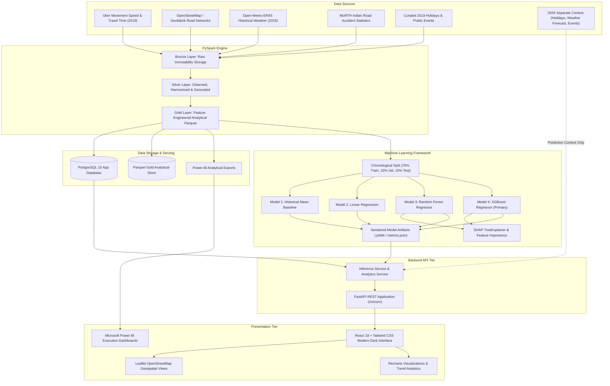

# ClearRoute — End-to-End System Architecture

## 1. High-Level Architectural Overview

ClearRoute is an enterprise-grade Big Data analytics and machine learning platform engineered to analyze historical urban congestion patterns and deliver multi-factor congestion forecasts across Indian metropolitan cities (**Delhi, Mumbai, Bengaluru, Hyderabad, and Kolkata**).

The architecture is strictly separated into six distinct tiers:
1. **Data Ingestion Tier (Bronze Layer)**: Captures raw extracts from Uber Movement, OpenStreetMap (OSM/Geofabrik), Open-Meteo ERA5 reanalysis, and Indian transport statistics.
2. **Big Data Processing Tier (Silver Layer)**: Apache PySpark data cleaning, schema enforcement, timestamp normalization, geographic matching, and outlier handling.
3. **Analytical & Feature Store Tier (Gold Layer)**: Unified analytical datasets stored in optimized Parquet format and mirrored into structured PostgreSQL tables.
4. **Machine Learning Tier**: Chronological train/val/test splits, 4 distinct model families (Baseline, Linear, Random Forest, XGBoost), and SHAP explainability.
5. **API & Serving Tier**: High-performance FastAPI application with Pydantic validation, connection pooling, and serialized inference models.
6. **Visualization Tier**: React + Vite dark-themed analytics dashboard, Recharts interactive data visualization, Leaflet OSM maps, and export pipelines for Microsoft Power BI.

---

## 2. Layer Definitions

### A. Bronze Layer (Raw Storage)
- Stores unaltered raw files exactly as extracted from Zenodo/Uber Movement, OpenStreetMap PBF/GeoJSON, and Open-Meteo API JSONs.
- Immutable: write-once, read-many.
- Path: `data/bronze/{source_name}/{city}/{year}/`

### B. Silver Layer (Cleaned & Standardized)
- Deduplication of traffic segment records.
- Normalization of timestamps to Indian Standard Time (`Asia/Kolkata` / UTC+05:30).
- Handling of missing values via temporal interpolation or segment-specific medians (never silent zero filling).
- Geometric validation of coordinates within municipal bounding boxes.
- Path: `data/silver/{domain}/`

### C. Gold Layer (Unified Analytical Store)
- Master analytical dataset partitioned by `city` and `month`.
- Incorporates lag features, rolling traffic averages, weather indicators, event distance/presence, and road characteristics.
- Optimized Parquet tables consumed by PySpark ML, scikit-learn/XGBoost, and Power BI.
- Path: `data/gold/master_congestion/`

---

## 3. Strict 2019 Historical vs. 2026 Context Isolation

To prevent **temporal data leakage** and **chronological contamination**, ClearRoute maintains an explicit physical and logical separation:
1. **Training Data Pipeline**: Strictly constrained to **April 1, 2019 – December 31, 2019**. All statistical aggregations, baseline calculations, and supervised learning weights derive entirely from this period.
2. **Prediction / Inference Context Pipeline**: Handles future scenarios (e.g., evaluating congestion during a scheduled 2026 concert in Mumbai or an October 2026 festival in Delhi).
3. The inference service constructs the feature vector dynamically by merging the user's selected 2026 contextual input with the trained model weights. Under no circumstances are 2026 records written into the Gold historical training partitions.

---

## 4. Hardware and Development Division Strategy

To accommodate limited development hardware without compromising Big Data capabilities:
- **Primary Laptop (Antigravity Workspace)**: Focuses on UI/UX, FastAPI REST API, database queries, inference engine, Power BI modeling, integration testing, and documentation.
- **Teammate Heavy Compute Laptop**: Executes distributed PySpark jobs over the full 2019 raw Uber Movement / OSM archives, trains the XGBoost and Random Forest models, runs SHAP batch value computation, and serializes the artifacts to `ml/artifacts/`.
- **Portability & Decoupling**: The backend loads pre-serialized model artifacts (`.joblib` / `metrics.json`) and queries the Gold database/parquet directly, enabling full end-to-end functionality on standard laptops.
