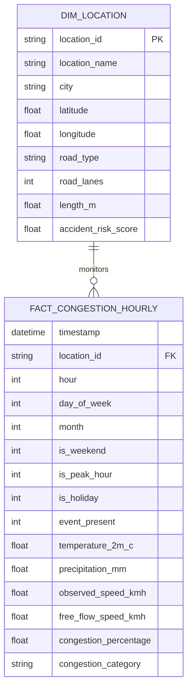

# ClearRoute — Power BI Data Dictionary & Semantic Model

## 1. Dimensional Model (Star Schema)

The ClearRoute Business Intelligence layer models traffic phenomena as a high-performance dimensional star schema centered on `fact_congestion_hourly` connected to `dim_location` and temporal dimensions.

---

## 2. Table Schemas & Data Dictionary

### Table A: `dim_location.csv`
| Column Name | Data Type | Nullable | Description & Domain |
| :--- | :--- | :---: | :--- |
| `location_id` | Text (PK) | No | Unique corridor identifier (e.g. `DEL_001`, `BOM_001`). |
| `location_name` | Text | No | Human-readable corridor name (e.g. "Laxmi Nagar", "Whitefield"). |
| `city` | Text | No | Metropolitan city: Delhi, Mumbai, Bengaluru, Hyderabad, Kolkata. |
| `latitude` | Decimal | No | WGS84 corridor centroid latitude. |
| `longitude` | Decimal | No | WGS84 corridor centroid longitude. |
| `road_type` | Text | No | OpenStreetMap classification (`trunk`, `primary`, `secondary`, `tertiary`). |
| `road_lanes` | Integer | No | Total carriageway lane count (e.g. 4, 6, 8 lanes). |
| `length_m` | Decimal | No | Physical road segment length in meters. |
| `accident_risk_score` | Decimal | No | Contextual hazard rating derived from MoRTH 2019 report (0.0 to 1.0). |

---

### Table B: `fact_congestion_hourly.csv`
| Column Name | Data Type | Nullable | Description & Domain |
| :--- | :--- | :---: | :--- |
| `timestamp` | DateTime | No | ISO 8601 Indian Standard Time (`Asia/Kolkata` / UTC+05:30). |
| `location_id` | Text (FK) | No | Foreign key linking to `dim_location.location_id`. |
| `hour` | Integer | No | Hour of day ($0 - 23$). |
| `day_of_week` | Integer | No | Day of week ($0 = \text{Monday}, 6 = \text{Sunday}$). |
| `month` | Integer | No | Calendar month ($4 - 12$ representing April–Dec 2019). |
| `is_weekend` | Integer | No | Binary flag: 1 for Saturday/Sunday, 0 for weekdays. |
| `is_peak_hour` | Integer | No | Binary flag: 1 for 08:00–11:00 and 17:00–21:00 IST. |
| `is_holiday` | Integer | No | Binary flag: 1 if national or gazetted regional holiday. |
| `event_present` | Integer | No | Binary flag: 1 if major assembly or cultural festival occurred. |
| `temperature_2m_c` | Decimal | No | Ambient air temperature at 2m in degrees Celsius (ERA5). |
| `precipitation_mm` | Decimal | No | Hourly precipitation in millimeters (ERA5 reanalysis). |
| `observed_speed_kmh`| Decimal | No | Harmonic mean observed velocity from Uber Movement. |
| `free_flow_speed_kmh`| Decimal | No | Empirical 85th/95th percentile off-peak velocity capacity. |
| `congestion_percentage`| Decimal | No | Derived Target: $\frac{v_{\text{free}} - v_{\text{obs}}}{v_{\text{free}}} \times 100\%$. |
| `congestion_category`| Text | No | Project display category: `Low`, `Moderate`, `High`, `Severe`. |

---

### Table C: `city_congestion_summary.csv`
- Pre-aggregated benchmarking table containing `city`, `avg_congestion_pct`, `peak_hour_congestion_pct`, `mean_speed_kmh`, and `corridors_monitored`.

### Table D: `hourly_congestion_summary.csv`
- Diurnal profile table mapping `hour`, `is_weekend`, `is_peak_hour`, `mean_congestion_pct`, and `mean_observed_speed_kmh`.

### Table E: `weather_impact_summary.csv`
- Categorized precipitation table mapping `rain_category` (`Dry`, `Light Rain`, `Moderate Rain`, `Heavy Monsoon`) to observed congestion percentage and vehicle speed degradation.

### Table F: `model_performance_summary.csv`
- Machine learning held-out test set benchmark table recording `model_key`, `model_name`, `algorithm_family`, `mae`, `rmse`, `r2_score`, and `is_champion`.
