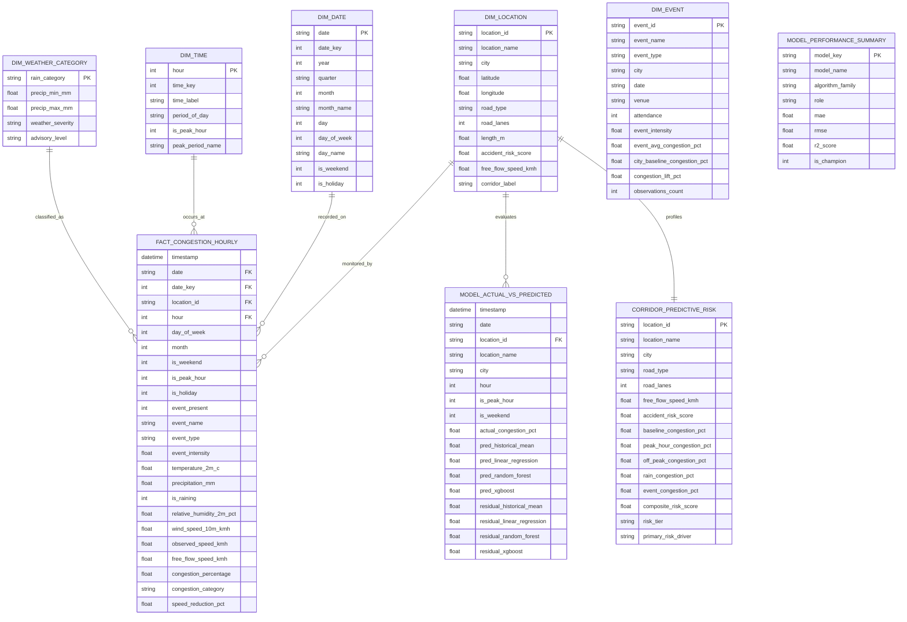

# ClearRoute — Power BI Data Dictionary & Semantic Model

## 1. Dimensional Model (Star / Snowflake Schema)

The ClearRoute Business Intelligence layer models multi-city transportation dynamics as a high-performance dimensional star schema centered on `fact_congestion_hourly` connected to spatial, temporal, event, and meteorological dimensions.

---

## 2. Table Specifications & Data Dictionary

### Table 1: `fact_congestion_hourly.csv`
- **Granularity**: Hourly corridor observation (Corridor $\times$ Timestamp).
- **Row Count**: 165,000 observations (April 1, 2019 – December 31, 2019).
- **Primary / Foreign Keys**: Foreign Keys to `dim_location.location_id`, `dim_date.date`, `dim_time.hour`.

| Column Name | Data Type | Nullable | Description & Domain |
| :--- | :--- | :---: | :--- |
| `timestamp` | DateTime | No | ISO 8601 Indian Standard Time (`YYYY-MM-DD HH:MM:SS`). |
| `date` | Date (FK) | No | Calendar date (`YYYY-MM-DD`) referencing `dim_date`. |
| `date_key` | Integer | No | Integer surrogate key (`YYYYMMDD`). |
| `location_id` | Text (FK) | No | Foreign key linking to `dim_location.location_id`. |
| `hour` | Integer (FK)| No | Hour of day ($0 - 23$) referencing `dim_time`. |
| `day_of_week` | Integer | No | Day of week ($0 = \text{Monday}, 6 = \text{Sunday}$). |
| `month` | Integer | No | Calendar month ($4 - 12$ representing April–Dec 2019). |
| `is_weekend` | Integer | No | Binary flag: 1 for Saturday/Sunday, 0 for weekdays. |
| `is_peak_hour`| Integer | No | Binary flag: 1 for 08:00–11:00 and 17:00–21:00 IST. |
| `is_holiday` | Integer | No | Binary flag: 1 if national or gazetted regional holiday. |
| `event_present`| Integer | No | Binary flag: 1 if major assembly or cultural festival occurred. |
| `event_name` | Text | No | Name of event or `"No Event"`. |
| `event_type` | Text | No | Classification: `Festival`, `Assembly`, `Public Holiday`, `Sports`, `No Event`. |
| `event_intensity` | Decimal | No | Normalized event impact factor ($0.0 - 1.0$). |
| `temperature_2m_c` | Decimal | No | Ambient air temperature at 2m in °C (ERA5). |
| `precipitation_mm` | Decimal | No | Hourly precipitation in millimeters (ERA5 reanalysis). |
| `is_raining` | Integer | No | Binary flag: 1 if precipitation $\ge 0.1\text{mm}$, else 0. |
| `relative_humidity_2m_pct`| Decimal | No | Relative atmospheric humidity ($0 - 100\%$). |
| `wind_speed_10m_kmh` | Decimal | No | Surface wind velocity in km/h. |
| `observed_speed_kmh` | Decimal | No | Harmonic mean observed velocity from Uber Movement. |
| `free_flow_speed_kmh`| Decimal | No | Empirical off-peak capacity velocity (85th/95th percentile). |
| `congestion_percentage`| Decimal | No | Target: $\frac{v_{\text{free}} - v_{\text{obs}}}{v_{\text{free}}} \times 100\%$. |
| `congestion_category` | Text | No | Project severity tier: `Low`, `Moderate`, `High`, `Severe`. |
| `speed_reduction_pct` | Decimal | No | Percentage velocity reduction from free-flow speed. |

---

### Table 2: `dim_location.csv`
- **Granularity**: Unique monitored transportation corridor (25 rows).
- **Primary Key**: `location_id`.

| Column Name | Data Type | Nullable | Description & Domain |
| :--- | :--- | :---: | :--- |
| `location_id` | Text (PK) | No | Unique corridor identifier (e.g. `BLR_001`, `DEL_001`). |
| `location_name` | Text | No | Corridor title (e.g. "Whitefield", "Central Silk Board"). |
| `city` | Text | No | Metro center: Bengaluru, Delhi, Hyderabad, Kolkata, Mumbai. |
| `latitude` | Decimal | No | WGS84 centroid latitude (Categorize as Latitude in Power BI). |
| `longitude` | Decimal | No | WGS84 centroid longitude (Categorize as Longitude in Power BI). |
| `road_type` | Text | No | OpenStreetMap classification (`trunk`, `primary`, `secondary`). |
| `road_lanes` | Integer | No | Physical carriageway lane count (4, 6, 8 lanes). |
| `length_m` | Decimal | No | Physical road segment length in meters. |
| `accident_risk_score` | Decimal | No | Contextual hazard rating derived from MoRTH 2019 ($0.0 - 1.0$). |
| `free_flow_speed_kmh` | Decimal | No | Design free-flow velocity in km/h. |
| `corridor_label` | Text | No | Combined title: `{city} — {location_name}`. |

---

### Table 3: `dim_date.csv`
- **Granularity**: Calendar day (275 rows spanning 2019-04-01 to 2019-12-31).
- **Primary Key**: `date`.

| Column Name | Data Type | Nullable | Description & Domain |
| :--- | :--- | :---: | :--- |
| `date` | Date (PK) | No | ISO Date string (`YYYY-MM-DD`). |
| `date_key` | Integer | No | Integer surrogate key (`YYYYMMDD`). |
| `year` | Integer | No | Calendar year (`2019`). |
| `quarter` | Text | No | Calendar quarter (`Q2`, `Q3`, `Q4`). |
| `month` | Integer | No | Calendar month number ($4 - 12$). |
| `month_name` | Text | No | Month title (`April`, `May`, ..., `December`). |
| `day` | Integer | No | Day of month ($1 - 31$). |
| `day_of_week` | Integer | No | Day of week index ($0 = \text{Monday}, 6 = \text{Sunday}$). |
| `day_name` | Text | No | Day title (`Monday`, ..., `Sunday`). |
| `is_weekend` | Integer | No | 1 for Saturday/Sunday, else 0. |
| `is_holiday` | Integer | No | 1 for gazetted holidays, else 0. |

---

### Table 4: `dim_time.csv`
- **Granularity**: Hourly diurnal cycle (24 rows: $0 - 23$).
- **Primary Key**: `hour`.

| Column Name | Data Type | Nullable | Description & Domain |
| :--- | :--- | :---: | :--- |
| `hour` | Integer (PK)| No | Hour of day ($0 - 23$). |
| `time_key` | Integer | No | Integer time key. |
| `time_label` | Text | No | Display label (`00:00`, `01:00`, ..., `23:00`). |
| `period_of_day` | Text | No | Diurnal band: `Morning Rush`, `Midday`, `Evening Rush`, `Night`, `Late Night`. |
| `is_peak_hour` | Integer | No | 1 for 08:00–11:00 & 17:00–21:00, else 0. |
| `peak_period_name`| Text | No | `Morning Peak (08:00-11:00)`, `Evening Peak (17:00-21:00)`, `Off-Peak`. |

---

### Table 5: `dim_event.csv`
- **Granularity**: Scheduled cultural, civic, or sporting event (21 rows).
- **Primary Key**: `event_id`.

| Column Name | Data Type | Nullable | Description & Domain |
| :--- | :--- | :---: | :--- |
| `event_id` | Text (PK) | No | Unique event identifier (`EVT_001` to `EVT_021`). |
| `event_name` | Text | No | Title of event (e.g. "Diwali Festival Evening", "Durga Puja"). |
| `event_type` | Text | No | Category: `Festival`, `Public Holiday`, `Assembly`, `Sports`. |
| `city` | Text | No | Metropolitan city of event. |
| `date` | Date | No | Occurrence date (`YYYY-MM-DD`). |
| `venue` | Text | No | Geographic venue / corridor epicenter. |
| `attendance` | Integer | No | Estimated participant turnout. |
| `event_intensity` | Decimal | No | Normalized intensity factor ($0.0 - 1.0$). |
| `event_avg_congestion_pct` | Decimal | No | Observed mean congestion in city during event day. |
| `city_baseline_congestion_pct` | Decimal | No | Non-event baseline mean congestion in that city. |
| `congestion_lift_pct` | Decimal | No | Percentage lift: $\text{Event} - \text{Baseline}$. |
| `observations_count` | Integer | No | Monitored hourly readings during event. |

---

### Table 6: `dim_weather_category.csv`
- **Granularity**: Rainfall intensity classification (4 tiers).
- **Primary Key**: `rain_category`.

| Column Name | Data Type | Nullable | Description & Domain |
| :--- | :--- | :---: | :--- |
| `rain_category` | Text (PK) | No | `Dry (<0.5mm)`, `Light Rain (0.5-5mm)`, `Moderate Rain (5-15mm)`, `Heavy Monsoon (>15mm)`. |
| `precip_min_mm` | Decimal | No | Lower bound precipitation in mm. |
| `precip_max_mm` | Decimal | No | Upper bound precipitation in mm. |
| `weather_severity` | Text | No | Severity level: `Normal`, `Moderate`, `High`, `Severe`. |
| `advisory_level` | Text | No | Recommended municipal advisory prompt. |

---

### Table 7: `model_performance_summary.csv`
- **Granularity**: Machine learning candidate model (4 rows).
- **Primary Key**: `model_key`.

| Column Name | Data Type | Nullable | Description & Domain |
| :--- | :--- | :---: | :--- |
| `model_key` | Text (PK) | No | Identifier: `historical_mean`, `linear_regression`, `random_forest`, `xgboost`. |
| `model_name` | Text | No | Full display title. |
| `algorithm_family`| Text | No | Statistical or algorithmic family. |
| `role` | Text | No | Evaluation role (`Statistical Baseline`, `Primary Forecasting Model`, etc.). |
| `mae` | Decimal | No | Test Mean Absolute Error (% Congestion). |
| `rmse` | Decimal | No | Test Root Mean Squared Error. |
| `r2_score` | Decimal | No | Test Coefficient of Determination ($R^2$). |
| `is_champion` | Integer | No | 1 if selected champion model, else 0. |

---

### Table 8: `model_actual_vs_predicted.csv`
- **Granularity**: Held-out chronological test set prediction (24,750 rows).
- **Evaluation Partition**: Nov 20, 2019 18:00 to Dec 31, 2019 23:00.

| Column Name | Data Type | Nullable | Description & Domain |
| :--- | :--- | :---: | :--- |
| `timestamp` | DateTime | No | Reading timestamp. |
| `date` | Date | No | Reading date. |
| `location_id` | Text (FK) | No | Corridor ID linking to `dim_location`. |
| `location_name` | Text | No | Corridor title. |
| `city` | Text | No | Metropolitan city. |
| `hour` | Integer | No | Hour of day ($0 - 23$). |
| `is_peak_hour` | Integer | No | 1 for peak commute hours, else 0. |
| `is_weekend` | Integer | No | 1 for weekend days, else 0. |
| `actual_congestion_pct` | Decimal | No | Ground-truth observed congestion percentage. |
| `pred_historical_mean` | Decimal | No | Prediction by Model 1 (Historical Mean Baseline). |
| `pred_linear_regression`| Decimal | No | Prediction by Model 2 (Ridge Linear Regression). |
| `pred_random_forest` | Decimal | No | Prediction by Model 3 (Random Forest Regressor). |
| `pred_xgboost` | Decimal | No | Prediction by Model 4 (XGBoost Regressor). |
| `residual_historical_mean`| Decimal | No | Error: $\text{Actual} - \text{Pred}_{\text{HistMean}}$. |
| `residual_linear_regression`| Decimal | No | Error: $\text{Actual} - \text{Pred}_{\text{Ridge}}$. |
| `residual_random_forest` | Decimal | No | Error: $\text{Actual} - \text{Pred}_{\text{RF}}$. |
| `residual_xgboost` | Decimal | No | Error: $\text{Actual} - \text{Pred}_{\text{XGBoost}}$. |

---

### Table 9: `corridor_predictive_risk.csv`
- **Granularity**: Monitored road corridor risk profile (25 rows).
- **Primary Key**: `location_id`.

| Column Name | Data Type | Nullable | Description & Domain |
| :--- | :--- | :---: | :--- |
| `location_id` | Text (PK) | No | Foreign key linking to `dim_location`. |
| `location_name` | Text | No | Corridor title. |
| `city` | Text | No | Metropolitan city. |
| `road_type` | Text | No | Road classification. |
| `road_lanes` | Integer | No | Carriageway lane capacity. |
| `free_flow_speed_kmh` | Decimal | No | Free flow speed capacity. |
| `accident_risk_score` | Decimal | No | Hazard rating derived from MoRTH report ($0.0 - 1.0$). |
| `baseline_congestion_pct` | Decimal | No | Overall mean observed congestion. |
| `peak_hour_congestion_pct` | Decimal | No | Mean congestion during morning & evening rush hours. |
| `off_peak_congestion_pct` | Decimal | No | Mean congestion during off-peak windows. |
| `rain_congestion_pct` | Decimal | No | Mean congestion during active rainfall. |
| `event_congestion_pct` | Decimal | No | Mean congestion during scheduled local events. |
| `composite_risk_score` | Decimal | No | Weighted hazard index ($0 - 100$). |
| `risk_tier` | Text | No | `Critical Risk`, `High Risk`, `Moderate Risk`, `Low Risk`. |
| `primary_risk_driver` | Text | No | Qualitative diagnostic explanation. |

---

### Table 10: `model_feature_importance.csv`
- **Granularity**: Model feature attribute (31 features).

| Column Name | Data Type | Nullable | Description & Domain |
| :--- | :--- | :---: | :--- |
| `feature_name` | Text | No | Preprocessor column name. |
| `display_name` | Text | No | Clean human-readable feature title. |
| `category` | Text | No | Category (`Time Of Day`, `Traffic History`, etc.). |
| `shap_importance_pct` | Decimal | No | Mean absolute SHAP attribution contribution (%). |
| `xgboost_importance` | Decimal | No | Gini impurity / gain importance in XGBoost. |
| `random_forest_importance`| Decimal | No | Random Forest permutation importance. |
| `ridge_coefficient` | Decimal | No | Standardized linear regression weight. |

---

### Table 11: `refresh_metadata.csv` / `refresh_metadata.json`
- **Granularity**: Audit metadata record (1 row).

| Column Name | Data Type | Description |
| :--- | :--- | :--- |
| `refresh_timestamp_utc` | DateTimeZone | Exact UTC timestamp of pipeline execution. |
| `refresh_date` | Date | Date of refresh (`YYYY-MM-DD`). |
| `source_dataset` | Text | Absolute path of Gold parquet source. |
| `source_dataset_records`| Integer | Exact count of rows processed (`165,000`). |
| `temporal_range_start` | Text | Starting observation timestamp (`2019-04-01 00:00:00`). |
| `temporal_range_end` | Text | Ending observation timestamp (`2019-12-31 23:00:00`). |
| `metropolitan_cities_count`| Integer | Metropolitan centers covered (`5`). |
| `corridors_monitored_count`| Integer | Monitored corridors (`25`). |
| `models_evaluated_count` | Integer | Evaluated models (`4`). |
| `champion_model_key` | Text | Champion model key (`historical_mean` or `xgboost`). |
| `champion_model_name` | Text | Champion model title. |
| `champion_test_mae` | Decimal | Test MAE of champion model (`2.675` or `2.727`). |
| `champion_test_rmse` | Decimal | Test RMSE of champion model (`3.405` or `3.464`). |
| `champion_test_r2` | Decimal | Test $R^2$ of champion model (`0.972`). |
| `pipeline_status` | Text | Status flag: `SUCCESS`. |
